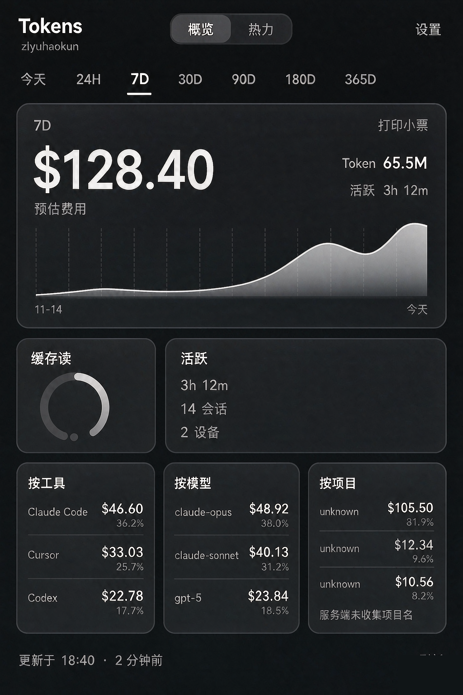
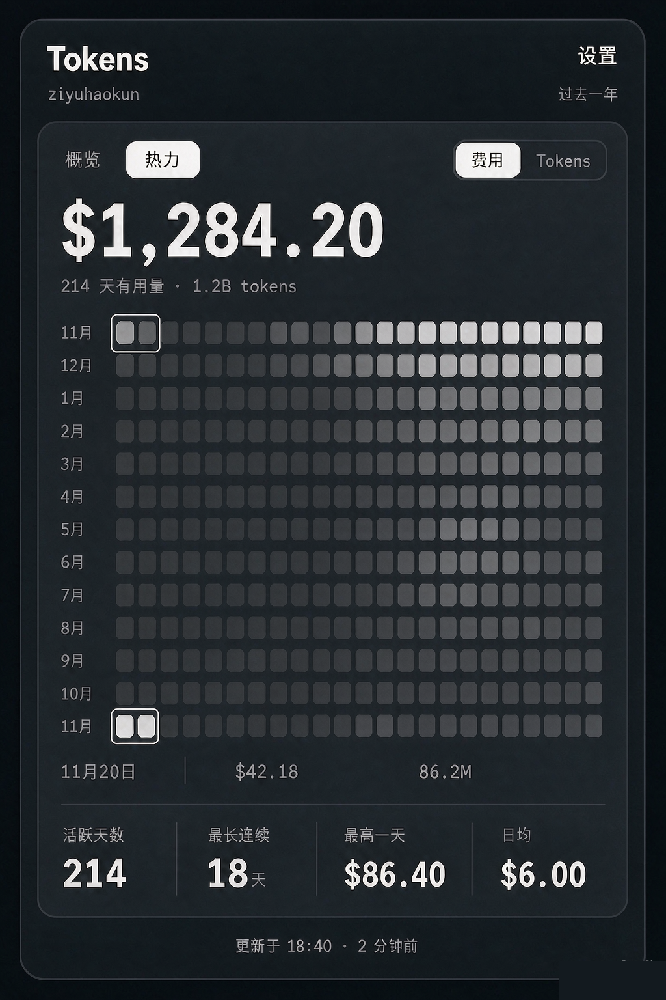
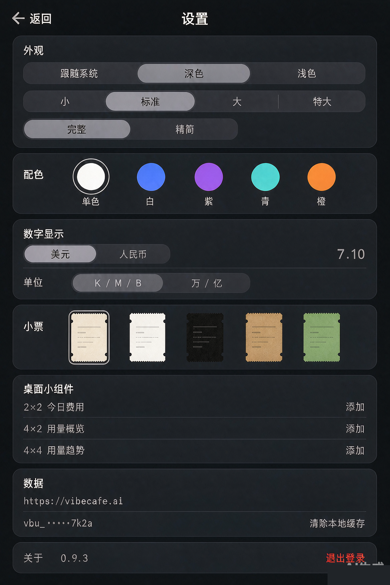
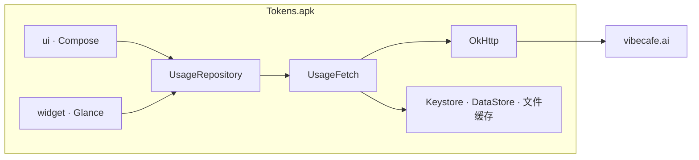

<p align="center">
  
</p>

<h1 align="center">Tokens</h1>

<p align="center">
  <strong>口袋里的云端用量。</strong> 一个页面、一张热力图、一个桌面小组件，只读。
</p>

<p align="center">
  
  
  
  
</p>

安卓上的 [vibecafe.ai](https://vibecafe.ai) 用量查看器。API Key 加密进 Android Keystore，用量缓存在本机，断网也能看上次的数字，不会出现假 0。

<p align="center">
  
</p>

`今天 / 24H / 7D / 30D / 90D / 180D / 365D` 随切随看。默认深色、纯黑白；颜色只落在大金额、选中标签、图表主线和热力图最亮一档。数字用打包的 JetBrains Mono。

## 立场

| 原则 | 落地 |
| --- | --- |
| 只读 | 用量只拉 `GET /api/usage`。上传和同步是 vibe-usage CLI 与桌面端的事。唯一的例外是检查更新：会访问 GitHub，见下面「自动更新」。 |
| 先真数，再缓存 | 成功才写缓存。失败显示上次那份和「更新于 HH:mm」，不编一个 0。 |
| 钥匙不出明文 | Keystore AES-GCM。设置页只露后 4 位。`allowBackup=false`，缓存放 `noBackupFilesDir`。 |
| 一个界面 | 概览、热力、设置浮层、小票。小组件只读同一份缓存，自己不发请求。 |

## 工作流

```text
登录（浏览器设备码，或粘贴 vbu_ key）→ 概览七档 → 热力 365 天
→ 打印小票，或放到桌面（2×2 / 4×2 / 4×4）
```

概览每一档：大号预估费用、token 总量、活跃时长、平滑面积图（今天只画到当前小时）、缓存读刻度环，以及按工具 / 模型 / 项目的三张排行。大字号时并排卡片改成单列，金额不跟着放大。页尾是「更新于 HH:mm · N 分钟前」，可下拉刷新。回前台只在数据老于 1 分钟时补拉。

热力把 365 天铺成日历格子，按费用或 Tokens 切换色阶。阈值取非零日的分位数，账号量级不同也不会一片死黑。点一天看金额、tokens、活跃时长；下面是活跃天数、最长连续、最高一天、日均。热力页和 365D 共用一份缓存。

<p align="center">
  
</p>

| 小组件 | 内容 |
| --- | --- |
| 2×2 今日费用 | 今日大金额 + 7 天迷你柱 |
| 4×2 用量概览 | 今日 / 7 天金额 + tokens + 柱 |
| 4×4 用量趋势 | 上面全部 + 7 天费用面积图 + 工具费用前三 |

点卡片进 App，点右上「刷新」立刻抓一次，两次之间至少隔 60 秒。外观跟随主题、强调色和货币。没配 Key 时显示「打开 App 填写 API Key」。系统小部件选择器里的预览是固定假数据，不泄露真实金额。配好 Key，或冷启动时缺 7 天缓存，会马上补一次；之后每 30 分钟由 WorkManager 在有网时刷新。

小票从概览主卡右上角走出，宽 300dp。纸上有单号、日期、输入 / 输出 / 缓存读写 / 推理、合计、按工具明细、活跃时长 / 会话数 / 消息数，以及条码。不含设备名、项目名、账号。五种纸型（经典热敏 / 极简白 / 夜间黑 / 牛皮纸 / 终端绿），三种语言（中文 / English / 混合）。纸色墨色写死，不跟主题走。可存到 `Pictures/Tokens/`，或从系统分享面板发出去。

设置没有「保存」按钮，点一下就落盘：主题（跟随系统 / 深色 / 浅色，从点击处圆形揭开，680ms）、强调色（单色 / 蓝 / 紫 / 青 / 橙）、字号（85%–130%）、动效（完整 / 精简）、货币（$ / ¥，汇率 1.0–20.0，默认 7.10）、token 单位（K/M/B 或 万/亿）、小票样式、小组件预览和「添加到桌面」。返回手势会把设置页右移、缩小、淡出，松手前能看到首页。

<p align="center">
  
</p>

## 数据口径

```text
tokens = input + output + cachedInput + reasoning + cacheCreation5m + cacheCreation1h
费用   = Σ estimatedCost（服务端算好的，本地不建定价表）
```

「今天」用 `from=<本机零点 ISO>`；24H / 7D / 30D / 90D 用 `days=N`；180D / 365D 用 `from` / `to` 日期。请求一律带 `tz=<本机 IANA 时区>`。同一账号、同一档如果已经有请求在飞，后来的调用等同一份结果，不打第二次。

## 从源码运行

Windows，JDK 21，Android SDK platform 37（minor 2）。`local.properties` 写 `sdk.dir`，用正斜杠。

```powershell
git clone git@github.com:ziyuhaokun/tokens.git
cd tokens
.\gradlew.bat :app:testDebugUnitTest :app:assembleDebug
```

产物 `app/build/outputs/apk/debug/app-debug.apk`。

正式包打开 R8 与资源压缩。签名四项写在本机 `~/.gradle/gradle.properties`，不入库：

```properties
TOKENS_STORE_FILE=C:/path/to/tokens-release.jks
TOKENS_STORE_PASSWORD=...
TOKENS_KEY_ALIAS=tokens
TOKENS_KEY_PASSWORD=...
```

```powershell
.\gradlew.bat :app:assembleRelease
```

没有这四项时 `assembleRelease` 会直接报错，不会再悄悄产出未签名包；只想自己装着试，用 `assembleDebug`。`.gitignore` 已忽略 `*.jks` / `*.keystore`。

登录有两条路，都在引导页。浏览器设备码：App 给出验证码并打开确认页，确认后自动完成；确认链接必须是 https，且和 API 地址同域名。手动：填 `vbu_…`，默认打码。高级设置可改服务器，默认 `https://vibecafe.ai`，只放行 https；本机调试可用 `http://localhost` / `127.0.0.1` / `10.0.2.2`。先验证，通过才落盘。退出登录会清 Key 和全部缓存。

桌面：长按空白处 → 小部件 → Tokens，或在设置页点「添加到桌面」。小米机型会另外引导打开「桌面快捷方式」权限。

## 架构



单模块 `:app`，`AppContainer` 手写组装，不上 Hilt / Retrofit / Room。

| 包 | 职责 |
| --- | --- |
| `ui` | 单 Activity。没配 Key 进引导页，否则概览 / 热力，设置和小票是浮层 |
| `widget` | 三个尺寸共用一个 Glance 卡片。WorkManager 每 30 分钟拉「今天」和「7 天」 |
| `data` | 请求、按账号分文件的缓存、聚合、设置。原始 JSON 只在写盘时留着 |
| `export` | 小票存相册，或经 FileProvider 交给系统分享 |

| 层 | 选型 |
| --- | --- |
| 构建 | Gradle 9.9.2 + AGP 9.5.1（内置 Kotlin）+ JDK 21 |
| SDK | compileSdk 37.2，targetSdk 37，minSdk 26 |
| UI | Compose BOM 2026.11.01 + Material 3 |
| 小组件 | Glance 1.2.0 |
| 后台 | WorkManager 2.12.0，联网约束 |
| 存储 | DataStore Preferences 1.3.0 + Keystore AES-GCM + `noBackupFilesDir` |
| 网络 | OkHttp 5.5.1。用量请求不跟随重定向、响应上限 8MB；更新下载只允许跟随到 GitHub 的发布文件域名；JSON 用 `org.json` |
| 测试 | JUnit 4，纯 JVM |

## 自动更新

新版本从本仓库的 GitHub Release 取，没有别的更新源。

- 进主界面后自动查一次最新 Release（距上次不到 6 小时不重复，失败不打扰你）；设置页「关于」里可手动检查。
- 发现新版本会弹窗，显示更新说明，可「更新 / 稍后 / 跳过此版本」。点「更新」才下载，不会在后台偷偷用流量。
- 安装前校验：附件的 SHA-256（GitHub 提供时）、包名、版本号必须更高、签名证书必须与当前 App 完全一致。下载的每一跳都只允许 https 的 `github.com` 与 GitHub 的发布文件域名。
- 校验通过后拉起系统安装器，最后一步一定要你在系统界面点确认；第一次需要允许「安装未知应用」。做不到静默安装。

## 隐私

没有统计、广告、崩溃上报，不写日志，不申请通讯录 / 定位 / 短信。用量只从你填的服务器读；除此之外，App 只会为检查和下载更新访问 GitHub，且不带 API Key。

| 场景 | 发出去的 | 去向 |
| --- | --- | --- |
| 用量请求 | Bearer API Key（`vbu_…`，HTTPS）、本机时区 | 你填的服务器，默认 vibecafe.ai |
| 设备码登录 | 厂商 + 型号、`clientName="Tokens Android"` | 同上 |
| 检查更新 / 下载新版本 | 只有请求本身（`User-Agent: Tokens-Android`），不带 Key、不带账号和设备信息 | `api.github.com`，下载走 `github.com` 与 GitHub 发布文件域名 |
| 小票分享 | 一张 PNG | 你自己选的分享目标 |

引导页输入 Key 时加 `FLAG_SECURE`，进主界面后去掉，方便截用量图。登录确认链接校验域名，请求不跟随重定向。

## 已知边界

- 不做自定义日期区间，也不做多账号。
- 项目名经常是 `unknown`：这个 App 从不上传项目名，收不收取决于上传端的设置。
- `sessions` 可能是空数组，这时「活跃」显示 0，并提示服务端没有 sessions。
- 界面文案目前只有中文。小票可以选 English 或中英混合。

**0.11.5** · 2026-11-22
